# TP1 : Déploiement d'un Portfolio Next.js avec Ansible et Semaphore UI

> Déploiement automatisé, idempotent et industrialisé d'une application Next.js sur une VM Linux, via Ansible (rôles modulaires) puis Semaphore UI.

---

## Table des matières

1. [Contexte et objectifs](#1-contexte-et-objectifs)
2. [Architecture et prérequis](#2-architecture-et-prérequis)
3. [Structure du projet Ansible](#3-structure-du-projet-ansible)
4. [Déploiement et idempotence](#4-déploiement-et-idempotence)
5. [Vérifications post-déploiement](#5-vérifications-post-déploiement)
6. [Industrialisation avec Semaphore UI](#6-industrialisation-avec-semaphore-ui)
7. [Difficultés rencontrées et solutions](#7-difficultés-rencontrées-et-solutions)
8. [Nettoyage de l'environnement](#8-nettoyage-de-lenvironnement)
9. [Conclusion](#9-conclusion)
10. [Index des captures d'écran](#10-index-des-captures-décran)

---

## 1. Contexte et objectifs

Ce TP a pour but d'automatiser le déploiement d'un portfolio Next.js sur un serveur cible, de prouver l'**idempotence** du playbook, puis d'exécuter ce même playbook depuis une interface web (**Semaphore UI**).

**Objectifs :**

- Structurer un projet Ansible en rôles réutilisables.
- Installer et configurer Node.js, PM2 et Nginx de façon reproductible.
- Démontrer l'idempotence (`changed=0` au second run).
- Passer d'une exécution en ligne de commande à une exécution orchestrée par Semaphore UI.

---

## 2. Architecture et prérequis

| Élément | Détail |
|---|---|
| Serveur cible | `devsecops-vm` (`192.168.56.10`) |
| Application | Next.js, dépôt `Narjess805/portfolio` |
| Orchestrateur | Semaphore UI (Docker, port `3001`) |
| Outil d'automatisation | Ansible 2.17 |
| Reverse proxy | Nginx (port `8000`) |
| Gestionnaire de processus | PM2 |

### Prérequis

- Accès SSH par clé à la VM cible, avec `sudo` fonctionnel.
- Ansible 2.17 installé sur le poste de contrôle.
- Docker installé pour exécuter Semaphore UI.

### Captures


*Arborescence du projet.*


*Versions des outils installés.*


*Test de connexion SSH et de `sudo` sur la cible.*

---

## 3. Structure du projet Ansible

| Rôle | Responsabilité |
|---|---|
| `roles/common` | Paquets de base, utilisateur `deploy`, `sudo` sans mot de passe (NOPASSWD) |
| `roles/nodejs` | Dépôt NodeSource, Node.js 20, PM2 |
| `roles/app` | Clone Git, `npm ci`, build, démarrage via PM2 |
| `roles/nginx` | Reverse proxy sur le port 8000 |

Cette séparation en rôles distincts suit les bonnes pratiques Ansible : chaque rôle a une responsabilité unique et peut être réutilisé indépendamment.

### Captures


*Fichiers racine du projet (playbook, configuration).*

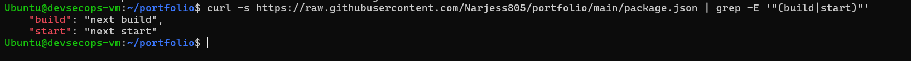
*État du dépôt avant l'ajout du code Ansible.*


*Dépôt `portfolio-deploy` sur GitHub.*

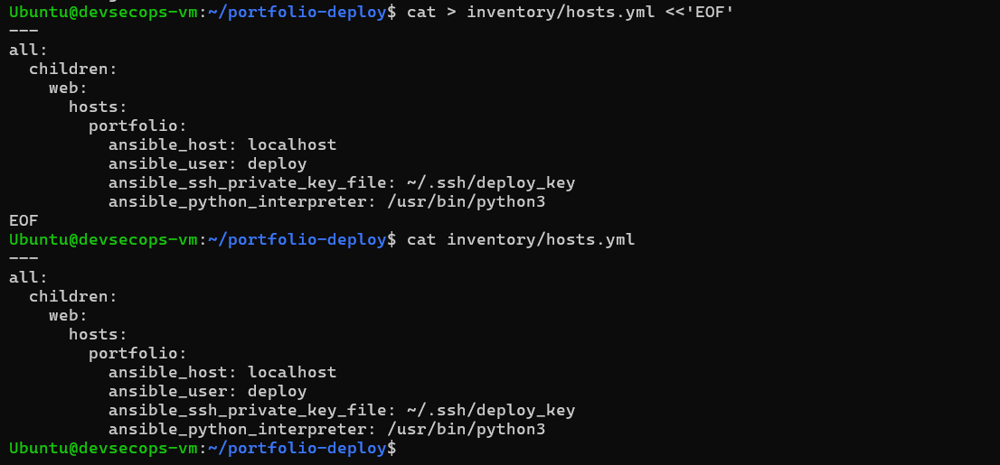
*Inventaire des hôtes.*

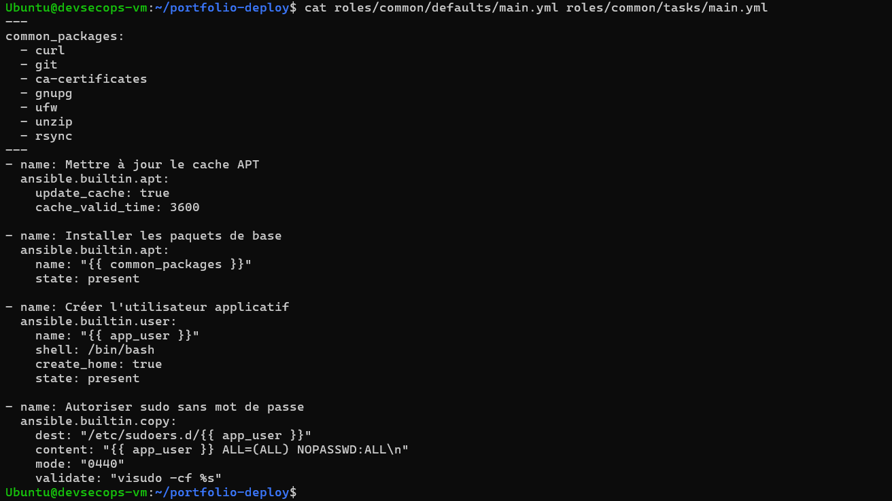
*Rôle `common`.*


*Rôle `nodejs`.*


*Rôle `app`.*


*Rôle `nginx`.*

---

## 4. Déploiement et idempotence

### 4.1 Préparation de la cible

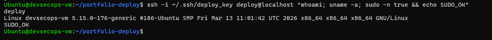
*Préparation de la VM avant le premier déploiement (voir aussi `02-ssh-cible.png`).*

### 4.2 Premier run : déploiement complet

```bash
ansible-playbook -i inventory playbook.yml
```

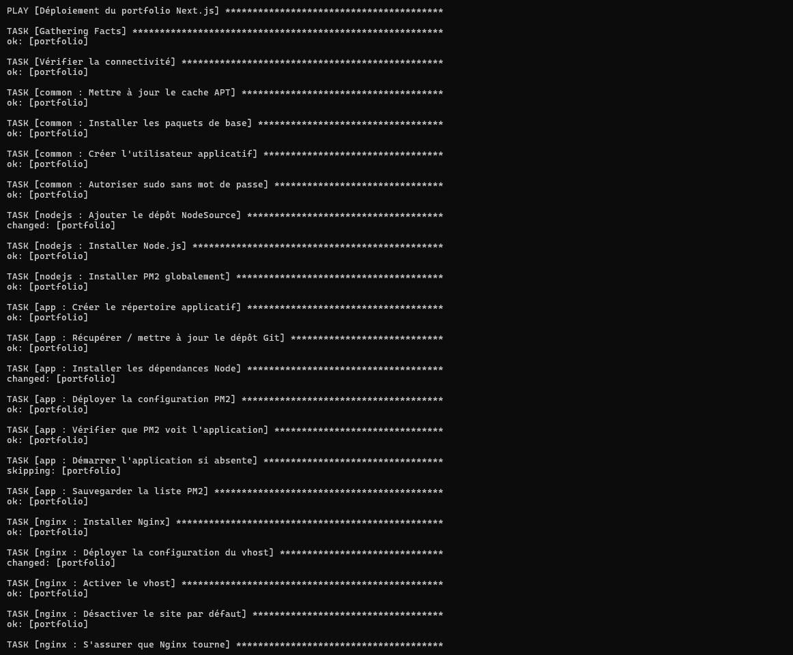
*Exécution des tâches lors du premier run.*


*Récapitulatif du premier run : les changements sont appliqués.*

### 4.3 Second run : preuve d'idempotence

Relancer le même playbook ne doit provoquer **aucune modification** (`changed=0`). Cela prouve que le playbook ne recrée pas ce qui existe déjà.


*Récapitulatif du second run : `changed=0`.*

---

## 5. Vérifications post-déploiement

| Vérification | Résultat attendu | Capture |
|---|---|---|
| Réponse HTTP de l'application | `HTTP 200` sur le port 8000 | `14-curl-app.png` |
| Rendu visuel | Portfolio affiché dans le navigateur | `15-navigateur-portfolio.png` |
| Processus PM2 | Application en statut `online` | `16-pm2-list.png` |
| Service Nginx | Service `active (running)` | `17-nginx-status.png` |


*L'application répond en HTTP 200.*

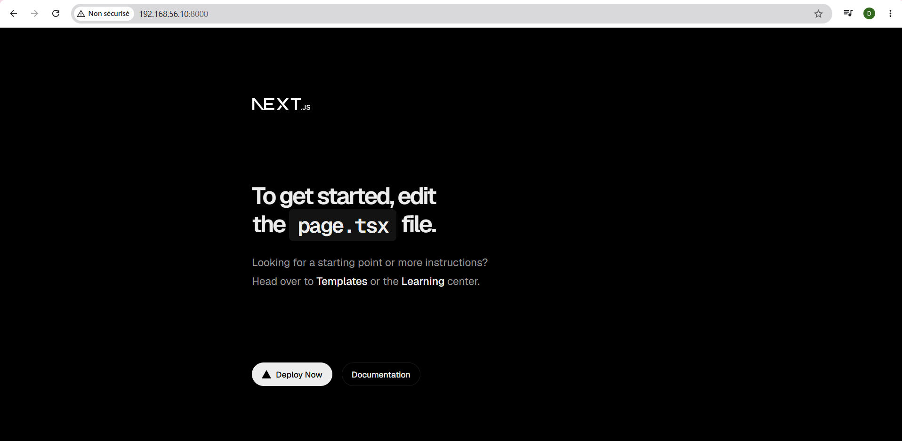
*Rendu du portfolio dans le navigateur.*

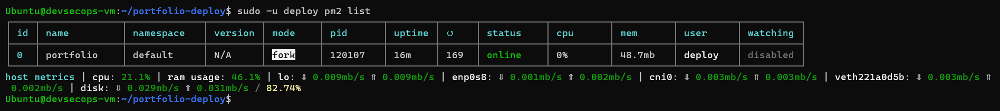
*Statut PM2.*


*Statut Nginx.*

---

## 6. Industrialisation avec Semaphore UI

Semaphore UI permet d'exécuter le playbook depuis une interface web, avec gestion centralisée des secrets et des inventaires.

**Objets configurés :**

1. **Key Store** : clés d'accès SSH.
2. **Inventory** : hôtes cibles.
3. **Repository** : dépôt Git contenant le projet Ansible.
4. **Variable Group** : variables d'environnement.
5. **Task Template** : modèle d'exécution du playbook.

### Captures

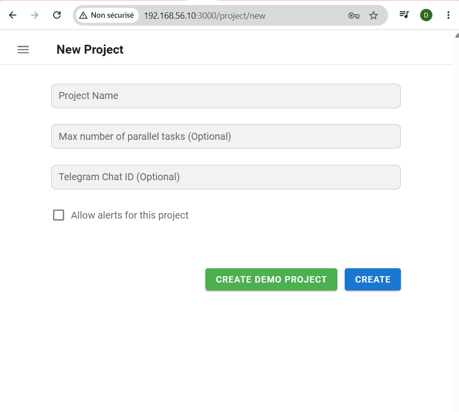
*Connexion au tableau de bord.*


*Key Store : clé SSH de déploiement.*


*Inventory : hôte cible.*


*Repository : dépôt Git du projet Ansible.*

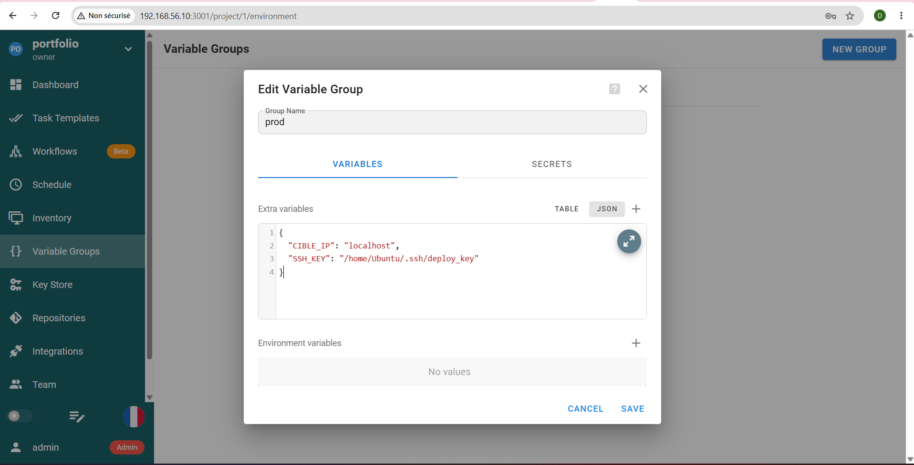
*Variable Group : variables d'environnement.*


*Task Template : modèle d'exécution du playbook.*

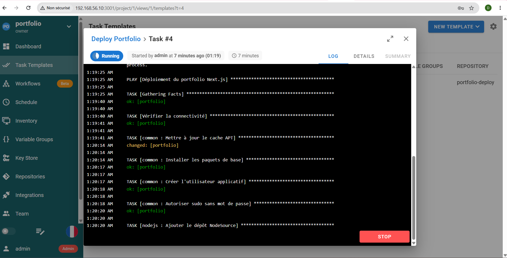
*Exécution du template en cours.*

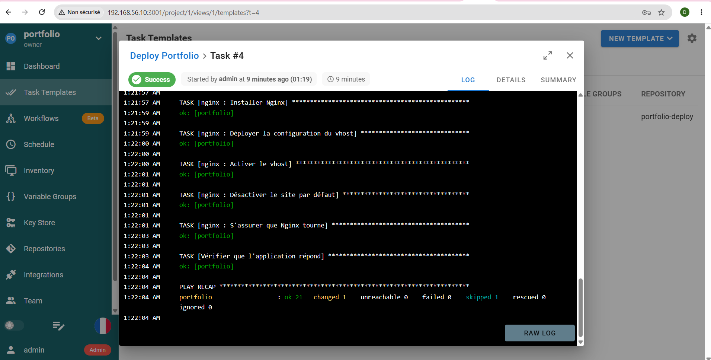
*Exécution réussie depuis l'interface.*

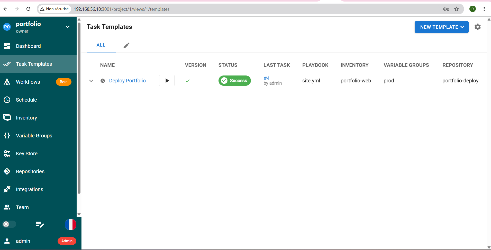
*Historique des tâches.*

---

## 7. Difficultés rencontrées et solutions

| Problème | Cause | Solution |
|---|---|---|
| `localhost:3000` inaccessible depuis Semaphore | Dans un conteneur Docker, `localhost` désigne le conteneur, pas la VM hôte | Utiliser l'adresse IP de la VM (`192.168.56.10`) |
| Conflit de port avec Nginx | Jenkins occupait déjà le port 80 | Configurer Nginx sur le port 8000 |

---

## 8. Nettoyage de l'environnement

```bash
# Arrêter et supprimer Semaphore
docker stop semaphore semaphore-db && docker rm semaphore semaphore-db

# (Optionnel) Arrêter le portfolio
sudo -u deploy pm2 stop all
```

---

## 9. Conclusion

- **Idempotence** : démontrée par `changed=0` au second run.
- **Modularité** : quatre rôles distincts, conformes aux bonnes pratiques Ansible.
- **Industrialisation** : passage de la CLI à une interface web avec gestion des clés et des inventaires.
- **Diagnostic réseau** : compréhension de la différence entre `localhost` dans un conteneur et sur l'hôte, et gestion des conflits de ports.

---

## 10. Index des captures d'écran

| N° | Fichier | Contenu |
|---|---|---|
| 00 | `00-arborescence.png` | Arborescence du projet |
| 01 | `01-versions-outils.png` | Versions des outils |
| 02 | `02-ssh-cible.png` | Test SSH et sudo |
| 03 | `03-semaphore-login.png` | Connexion Semaphore |
| 04 | `04-fichiers-racine.png` | Fichiers racine |
| 05 | `05-avant-ansible-repo.png` | Dépôt avant Ansible |
| 05b | `05b-repo-github.png` | Dépôt GitHub |
| 05 | `05-inventaire.png` | Inventaire |
| 06 | `06-role-common.png` | Rôle common |
| 07 | `07-role-nodejs.png` | Rôle nodejs |
| 08 | `08-role-app.png` | Rôle app |
| 09 | `09-role-nginx.png` | Rôle nginx |
| 10 | `10-prep-cible.png` | Préparation de la cible |
| 11 | `11-run1-tasks.png` | Run 1 : tâches |
| 12 | `12-run1-recap.png` | Run 1 : récapitulatif |
| 13 | `13-run2-recap.png` | Run 2 : idempotence |
| 14 | `14-curl-app.png` | Test curl |
| 15 | `15-navigateur-portfolio.png` | Rendu navigateur |
| 16 | `16-pm2-list.png` | Statut PM2 |
| 17 | `17-nginx-status.png` | Statut Nginx |
| 18 | `18-semaphore-key.png` | Key Store |
| 19 | `19-semaphore-inventory.png` | Inventory |
| 20 | `20-semaphore-repo.png` | Repository |
| 21 | `21-semaphore-env.png` | Variable Group |
| 22 | `22-semaphore-template.png` | Task Template |
| 23 | `23-semaphore-running.png` | Exécution en cours |
| 24 | `24-semaphore-success.png` | Exécution réussie |
| 25 | `25-semaphore-history.png` | Historique des tâches |
