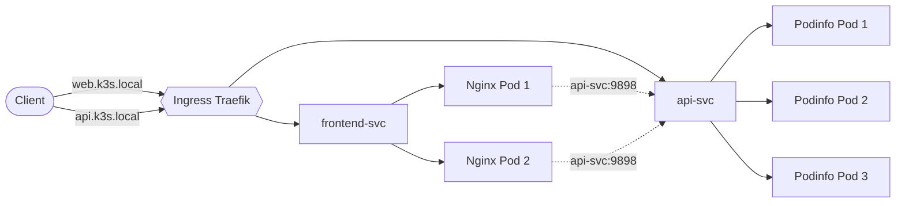

<div align="center">

# Mini-projet 1 : Application web à deux niveaux sur Kubernetes (K3s)

Déploiement, exposition via Ingress, mise à jour sans coupure et diagnostic de panne


</div>

---

## Table des matières

1. [Contexte et objectifs](#1-contexte-et-objectifs)
2. [Architecture](#2-architecture)
3. [Structure du dépôt](#3-structure-du-dépôt)
4. [Prérequis](#4-prérequis)
5. [Guide de déploiement](#5-guide-de-déploiement)
6. [Preuves d'exécution](#6-preuves-dexécution)
7. [Questions de réflexion](#7-questions-de-réflexion)
8. [Difficultés rencontrées](#8-difficultés-rencontrées)
9. [Nettoyage](#9-nettoyage)
10. [Auteur](#10-auteur)

---

## 1. Contexte et objectifs

Ce dépôt contient les manifestes YAML et la documentation du **Mini-projet 1**.

L'objectif est de déployer une application à deux niveaux (un frontend et une API) sur un cluster Kubernetes léger (K3s) et de :

- faire communiquer les deux composants **en interne** via des Services ;
- les **exposer à l'extérieur** grâce à un Ingress Traefik ;
- démontrer une **mise à jour sans coupure** (Rolling Update) ;
- réaliser un **diagnostic de panne** (`ImagePullBackOff`).

## 2. Architecture

| Composant | Technologie | Réplicas | Service |
|-----------|-------------|:--------:|---------|
| Frontend  | Nginx       | 2        | `frontend-svc` (ClusterIP) |
| API       | Podinfo     | 3        | `api-svc` (ClusterIP) |
| Routage   | Ingress Traefik | n/a  | `web.k3s.local` et `api.k3s.local` |

**Namespace** : `projet-narjess`



## 3. Structure du dépôt

```text
.
├── README.md                      # Documentation du projet
├── manifests/                     # Manifestes Kubernetes
│   ├── api-deployment.yaml        # Deployment de l'API (Podinfo)
│   ├── frontend-deployment.yaml   # Deployment du Frontend (Nginx)
│   ├── services.yaml              # Services ClusterIP (api-svc, frontend-svc)
│   └── ingress.yaml               # Ingress pour l'accès externe
└── captures/                      # Captures d'écran du projet
    ├── 00_namespace.png
    ├── 01_api_pods.png
    ├── 02_frontend_pods.png
    ├── 03_services_communication.png
    ├── 04_ingress.png
    ├── 05_rolling_update.png
    ├── 06_diagnostic.png
    └── 07_nettoyage.png
```

## 4. Prérequis

- Un cluster **K3s** fonctionnel (au moins 1 master et 1 worker)
- `kubectl` configuré sur votre machine
- **Traefik** installé (inclus par défaut avec K3s)

## 5. Guide de déploiement

### 5.1 Déployer l'application

Depuis la racine du dépôt :

```bash
kubectl create namespace projet-narjess
kubectl config set-context --current --namespace=projet-narjess
kubectl apply -f manifests/
```

### 5.2 Vérifier le déploiement

```bash
# Pods en état Running et nœuds d'exécution
kubectl get pods -o wide

# Services et endpoints associés
kubectl get services
kubectl get endpoints

# Ingress et adresse attribuée
kubectl get ingress
```

### 5.3 Tester l'accès externe

Ajoutez l'IP du nœud master dans le fichier `hosts` de votre machine :

```text
192.168.56.20  web.k3s.local api.k3s.local
```

| Système | Emplacement du fichier `hosts` |
|---------|--------------------------------|
| Linux / macOS | `/etc/hosts` |
| Windows | `C:\Windows\System32\drivers\etc\hosts` (éditeur lancé en administrateur) |

Puis accédez aux applications :

| Application | URL |
|-------------|-----|
| Frontend | http://web.k3s.local |
| API | http://api.k3s.local |

```bash
curl http://web.k3s.local
curl http://api.k3s.local
```

### 5.4 Mise à jour sans coupure et rollback

```bash
# Mise à jour de l'image (remplacer <nouveau-tag>)
kubectl set image deployment/<nom-deployment> <conteneur>=<image>:<nouveau-tag>

# Suivi de la mise à jour
kubectl rollout status deployment/<nom-deployment>

# Historique et ReplicaSets
kubectl rollout history deployment/<nom-deployment>
kubectl get rs

# Retour arrière si nécessaire
kubectl rollout undo deployment/<nom-deployment>
```

### 5.5 Diagnostic d'une panne

```bash
kubectl get pods
kubectl describe pod <nom-du-pod>
kubectl get events --sort-by=.metadata.creationTimestamp
kubectl logs <nom-du-pod>
```

## 6. Preuves d'exécution

### 6.1 Création du Namespace


### 6.2 Déploiement de l'API (3 réplicas)


### 6.3 Déploiement du Frontend (2 réplicas)


### 6.4 Communication interne (Frontend vers API)


### 6.5 Exposition avec Ingress


### 6.6 Mise à jour sans coupure (Rolling Update)


### 6.7 Diagnostic de panne


### 6.8 Nettoyage


## 7. Questions de réflexion

<details>
<summary><strong>Étape 0 : Pourquoi isoler un projet dans un namespace ?</strong></summary>

Le namespace isole les ressources (Pods, Services, etc.) afin d'éviter les conflits de noms, de faciliter la gestion des droits (RBAC) et de cibler plus simplement les commandes.
</details>

<details>
<summary><strong>Étape 1 : Sur quels nœuds les Pods sont-ils répartis, et qui a pris cette décision ?</strong></summary>

Les Pods sont répartis sur les différents nœuds (master et workers). C'est le **Scheduler** de Kubernetes qui décide, en fonction des ressources disponibles et des contraintes de placement.
</details>

<details>
<summary><strong>Étape 2 : Que se passerait-il si les deux Deployments utilisaient exactement les mêmes labels ?</strong></summary>

Les Services ne sauraient plus quels Pods cibler. Le Service `frontend-svc` pourrait envoyer du trafic vers l'API (et inversement), ce qui provoquerait un dysfonctionnement complet.
</details>

<details>
<summary><strong>Étape 3 : Quel est le nom DNS complet d'un Service ?</strong></summary>

Le FQDN a la forme `<service>.<namespace>.svc.cluster.local`.
Exemple : `api-svc.projet-narjess.svc.cluster.local`.
</details>

<details>
<summary><strong>Étape 4 : Pourquoi préférer un Ingress à deux Services NodePort ?</strong></summary>

L'Ingress fournit un point d'entrée unique (ports 80/443) avec routage par nom d'hôte et par chemin. Avec des NodePort, il faut ouvrir un port distinct par application, ce qui est moins lisible et moins sécurisé.
</details>

<details>
<summary><strong>Étape 5 : Combien de ReplicaSets existent après la mise à jour, et pourquoi l'ancien est-il conservé ?</strong></summary>

Il y a **2 ReplicaSets** : l'ancien (0 réplica) et le nouveau (3 réplicas). L'ancien est conservé pour permettre un rollback rapide avec `kubectl rollout undo` en cas de problème.
</details>

<details>
<summary><strong>Étape 6 : Quels symptômes ont mis sur la piste, et quelle est la cause racine ?</strong></summary>

- **Symptômes** : les Pods restent en `ErrImagePull` puis `ImagePullBackOff`.
- **Cause racine** : le tag d'image indiqué dans le manifeste n'existe pas sur le registre (GHCR), Kubernetes ne peut donc pas télécharger l'image.
</details>

## 8. Difficultés rencontrées

| Problème | Cause | Solution |
|----------|-------|----------|
| Endpoints à `<none>` | Les labels du Service ne correspondent pas à ceux du Deployment | Aligner `selector` du Service et `labels` du Pod template |
| Rolling update lent | Téléchargement des images depuis Internet | Vérifier la connectivité et préchauffer les images |
| `hosts` non pris en compte (Windows) | Fichier édité sans droits administrateur ou enregistré avec une extension | Éditer en administrateur et enregistrer sans extension |

## 9. Nettoyage

```bash
kubectl delete -f manifests/
kubectl delete namespace projet-narjess
```

## 10. Auteur

| | |
|---|---|
| **Nom** | Dabbech |
| **Prénom** | Narjess |
| **Classe** | M2 DevOps |
| **GitHub** | [@Narjess805](https://github.com/Narjess805) |
| **Date** | Octobre 2026 |
