# TP1 : Déploiement d'un Portfolio Next.js avec Ansible et Semaphore UI

Déploiement automatisé et idempotent d'un portfolio Next.js sur un serveur Ubuntu, avec un playbook Ansible structuré en rôles, puis industrialisation de son exécution avec Semaphore UI.

**Dépôt applicatif :** [`Narjess805/portfolio`](https://github.com/Narjess805/portfolio)
**Dépôt de déploiement :** [`Narjess805/portfolio-deploy`](https://github.com/Narjess805/portfolio-deploy)

---

## Sommaire

1. [Objectifs pédagogiques](#1-objectifs-pédagogiques)
2. [Prérequis et environnement](#2-prérequis-et-environnement)
3. [Architecture cible](#3-architecture-cible)
4. [Partie A : Playbook Ansible](#4-partie-a--playbook-ansible-ligne-de-commande)
5. [Partie B : Industrialisation avec Semaphore UI](#5-partie-b--industrialisation-avec-semaphore-ui)
6. [Livrables](#6-livrables)
7. [Adaptations et difficultés rencontrées](#7-adaptations-et-difficultés-rencontrées)
8. [Conclusion](#8-conclusion)

---

## 1. Objectifs pédagogiques

- Écrire un playbook Ansible **idempotent**, structuré en **rôles**.
- Automatiser le déploiement d'une application Next.js sur un serveur Linux.
- Industrialiser l'exécution avec **Semaphore UI** (inventaire, dépôt, clés, templates).

---

## 2. Prérequis et environnement

| Élément | Détail |
|---|---|
| Serveur cible | `devsecops-vm` (Ubuntu), IP `192.168.56.10`, accès SSH par clé (utilisateur `deploy`) |
| Poste de contrôle | Ansible 2.17, Git |
| Semaphore UI | Instance Docker, accessible sur le port `3001` |
| Application | Portfolio Next.js, dépôt `Narjess805/portfolio` |

### Vérifications de l'environnement

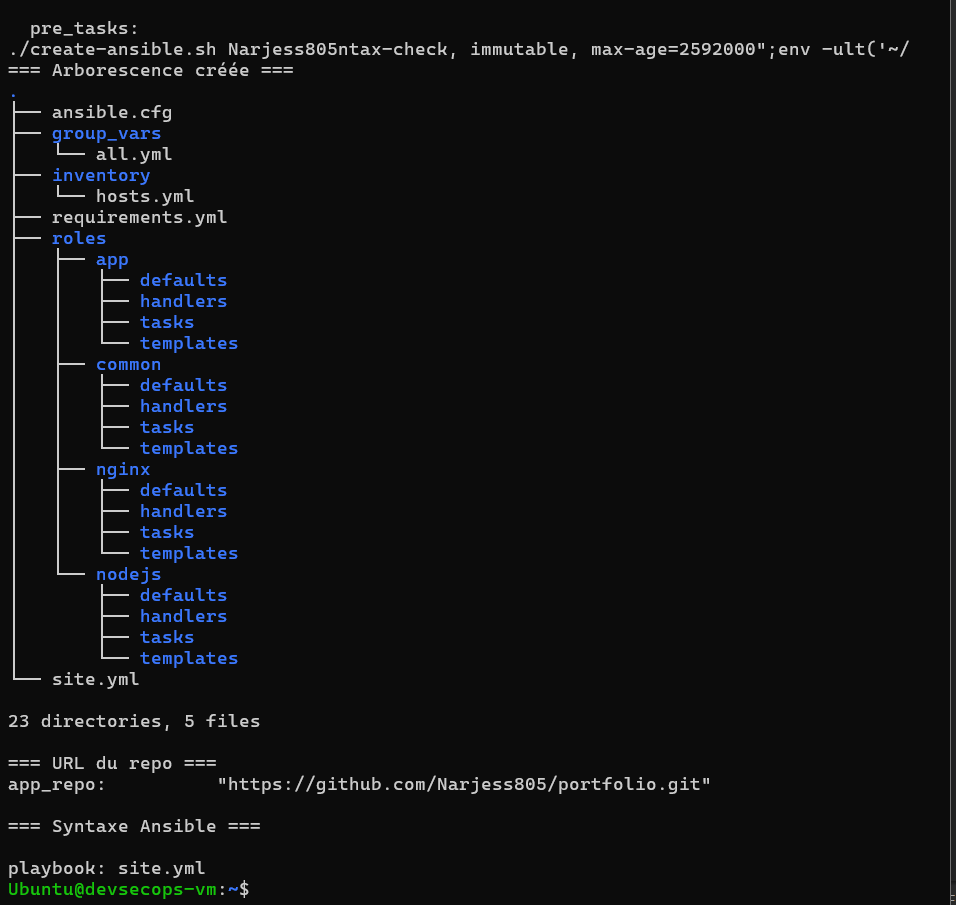
*Arborescence du projet de déploiement.*

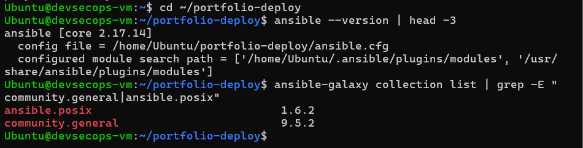
*Versions des outils installés (Ansible, Git, Docker…).*

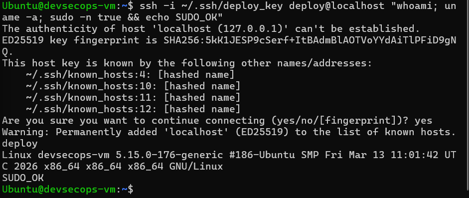
*Connexion SSH par clé et `sudo` fonctionnel sur la cible.*

---

## 3. Architecture cible

```
Semaphore UI ──► Dépôt Git (portfolio-deploy)
      │
      └──► Ansible ──► Serveur cible (192.168.56.10)
                          ├── Node.js 20 + PM2 (application Next.js, port 3000)
                          └── Nginx (reverse proxy, port 8000)
```

Le flux : Semaphore récupère le dépôt Git, exécute Ansible, qui configure le serveur (Node.js, application via PM2, Nginx en reverse proxy).

---

## 4. Partie A : Playbook Ansible (ligne de commande)

### 4.1 Structure du projet

```
portfolio-deploy/
├── ansible.cfg
├── inventory/
├── group_vars/
├── site.yml
├── requirements.yml
└── roles/
    ├── common/
    ├── nodejs/
    ├── app/
    └── nginx/
```

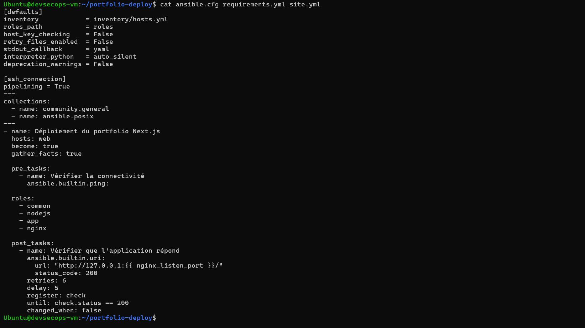
*Fichiers racine du projet : `ansible.cfg`, `site.yml`, `requirements.yml`.*


*État du dépôt avant l'ajout du code Ansible.*

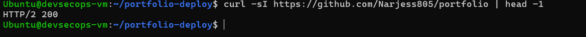
*Dépôt `portfolio-deploy` créé sur GitHub.*


*Inventaire des hôtes cibles.*

### 4.2 Rôles et responsabilités

| # | Rôle | Tâches réalisées | Modules utilisés |
|---|---|---|---|
| 1 | `common` | Mise à jour du cache apt, installation de `git`, `curl`, `build-essential`, création de l'utilisateur `deploy`, `sudo` sans mot de passe | `apt`, `user` |
| 2 | `nodejs` | Ajout du dépôt NodeSource, installation de Node.js 20 et de PM2 | `get_url`, `apt`, `npm` |
| 3 | `app` | Clone du dépôt dans `/opt/portfolio`, `npm ci`, `npm run build`, démarrage via PM2 | `git`, `command`, `shell` |
| 4 | `nginx` | Installation, vhost via template Jinja2 (`proxy_pass` vers l'application), activation du site | `apt`, `template`, `file`, `service` |

**Contraintes respectées :**

- Le redémarrage de l'application n'a lieu que si le code a changé (**handler + `notify`**).
- Le rechargement de Nginx passe par un **handler**.
- Aucune valeur en dur : les paramètres sont centralisés dans `group_vars/all.yml`.


*Rôle `common`.*

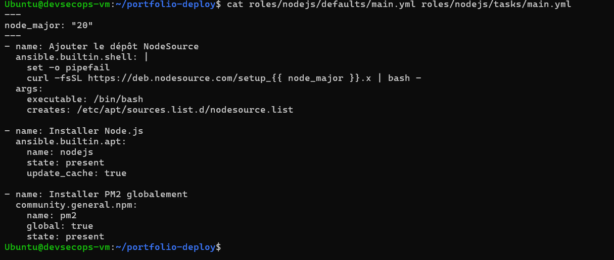
*Rôle `nodejs`.*

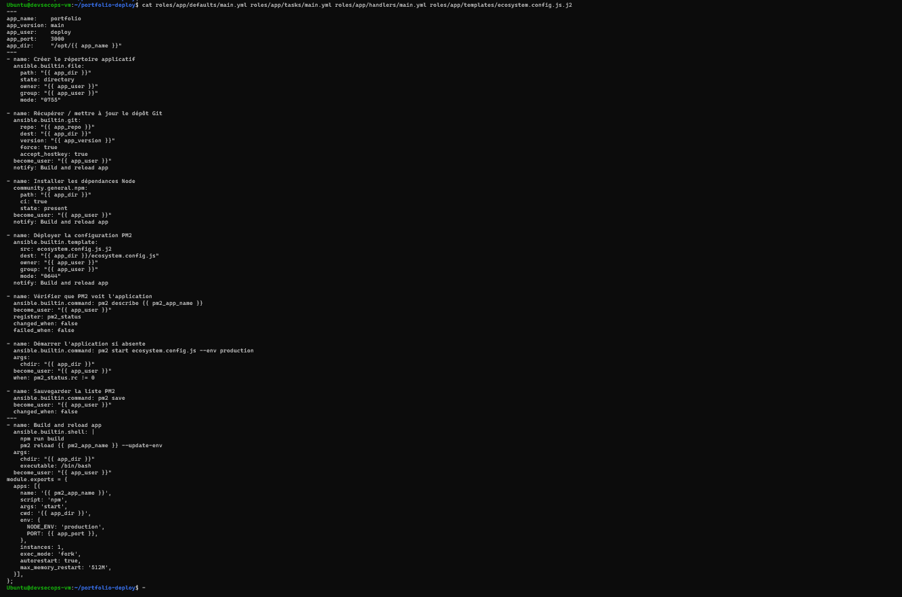
*Rôle `app`.*

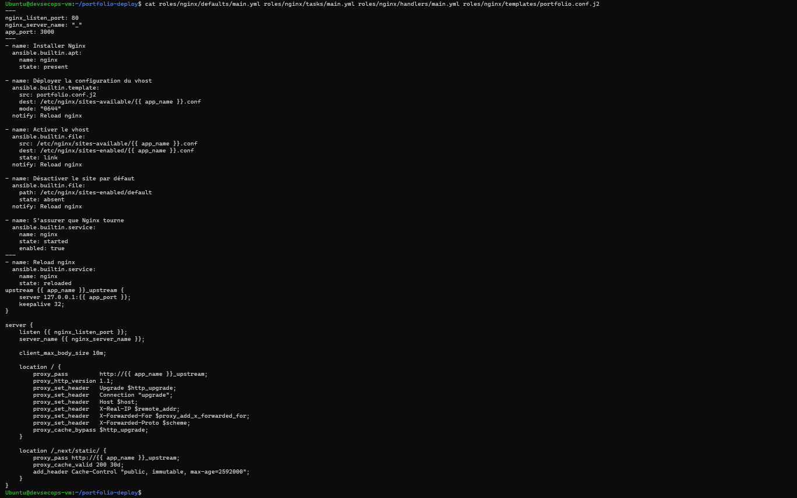
*Rôle `nginx`.*

### 4.3 Validation

```bash
ansible-playbook -i inventory/hosts.ini site.yml --syntax-check
ansible-playbook -i inventory/hosts.ini site.yml --check --diff
ansible-playbook -i inventory/hosts.ini site.yml        # 1er run
ansible-playbook -i inventory/hosts.ini site.yml        # 2e run
```

**Préparation de la cible**


*Préparation de la VM avant le premier déploiement.*

**1er run : déploiement complet**


*Exécution des tâches du premier run.*

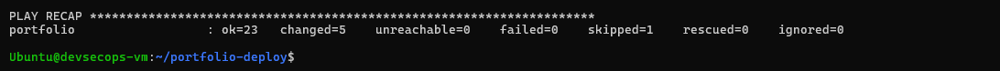
*Récapitulatif du premier run : les changements sont appliqués.*

**2e run : preuve d'idempotence**

Critère de réussite : la 2ᵉ exécution affiche `changed=0`.

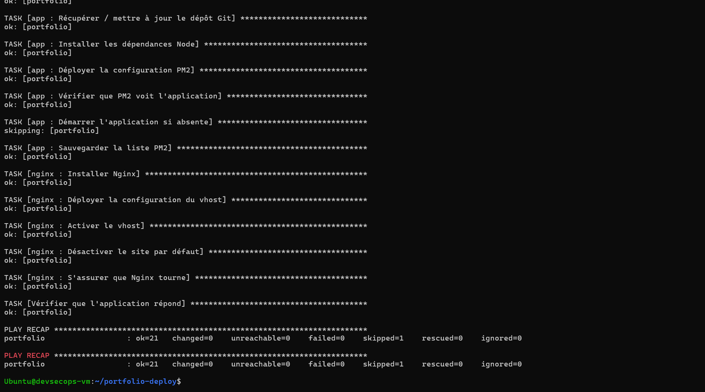
*Récapitulatif du 2ᵉ run : `changed=0`, le playbook est idempotent.*

**Vérifications post-déploiement**

| Vérification | Résultat attendu |
|---|---|
| Réponse HTTP de l'application | `HTTP 200` |
| Rendu dans le navigateur | Portfolio affiché |
| Processus PM2 | Application `online` |
| Service Nginx | `active (running)` |

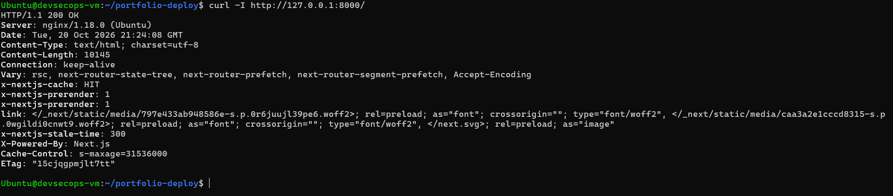
*L'application répond en HTTP 200.*


*Portfolio visible dans le navigateur.*


*Statut PM2 : application `online`.*

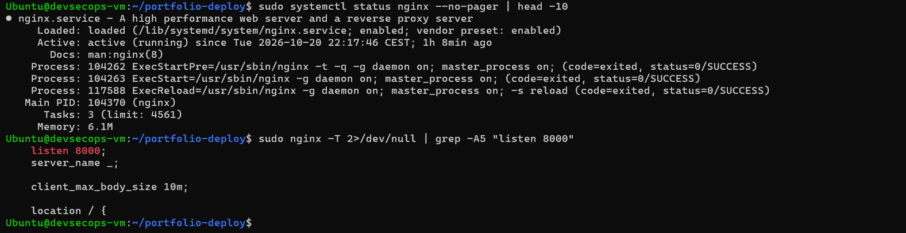
*Statut Nginx : `active (running)`.*

**Checklist de la partie A**

- [x] `--syntax-check` OK
- [x] 1ʳᵉ exécution sans erreur
- [x] 2ᵉ exécution : `changed=0`
- [x] Portfolio visible dans le navigateur

---

## 5. Partie B : Industrialisation avec Semaphore UI

### 5.1 Configuration

| Étape | Menu Semaphore | Paramètres |
|---|---|---|
| 1 | Projects → New | Projet `portfolio-deploy` |
| 2 | Key Store | Clé SSH d'accès au serveur |
| 3 | Repositories | URL du dépôt, branche, clé d'accès |
| 4 | Inventory | Inventaire statique (même contenu que `hosts.ini`), clé SSH associée |
| 5 | Variable Groups | Variables d'environnement (format JSON) |
| 6 | Task Templates | Playbook `site.yml`, Inventory, Repository, Variable Group |


*Connexion à Semaphore et création du projet.*

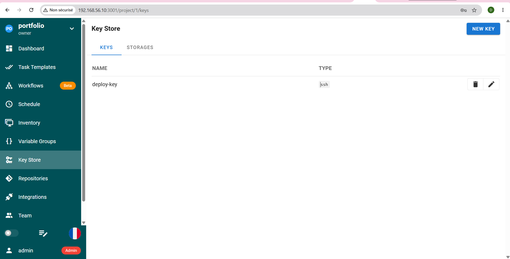
*Key Store : clé SSH de déploiement.*

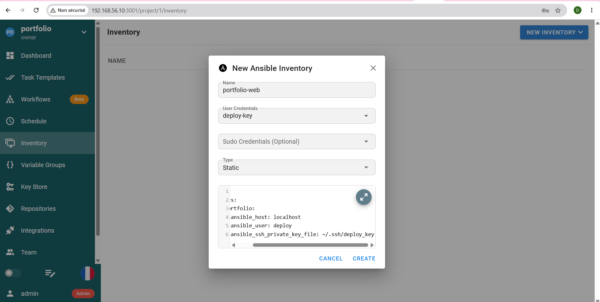
*Inventory : hôte cible.*

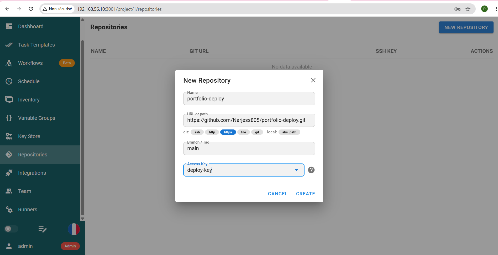
*Repository : dépôt Git du projet Ansible.*


*Variable Group : variables d'environnement.*

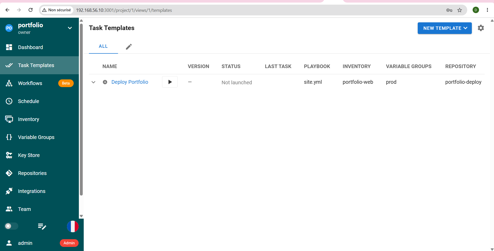
*Task Template configuré.*

### 5.2 Exécution et vérification


*Exécution du template, logs en direct.*


*Exécution réussie depuis l'interface.*


*Historique des tâches exécutées.*

---

## 6. Livrables

| Livrable | Statut |
|---|---|
| Dépôt Git avec les rôles complétés et ce README adapté | ✅ |
| `captures/semaphore-template.png` | ✅ |
| `captures/semaphore-run.png` | ✅ |
| `captures/portfolio.png` | ✅ |
| `captures/idempotence.png` (2ᵉ run à `changed=0`) | ✅ |
| Rapport d'une page (`RAPPORT.md`) | à rédiger |

---

## 7. Adaptations et difficultés rencontrées

| Sujet | Énoncé | Réalisé | Raison |
|---|---|---|---|
| Port de Nginx | 80 | 8000 | Jenkins occupait déjà le port 80 sur la VM |
| Port de Semaphore | 3000 | 3001 | Éviter le conflit avec le port 3000 de l'application |

| Problème | Cause | Solution |
|---|---|---|
| Hôte injoignable depuis Semaphore avec `localhost` | Dans un conteneur Docker, `localhost` désigne le conteneur et non la VM hôte | Utiliser l'IP de la VM (`192.168.56.10`) dans l'inventaire |
| Clé SSH non trouvée par Semaphore | Le conteneur ne voit pas les fichiers de l'hôte | Enregistrer la clé dans le **Key Store** de Semaphore |

---

## 8. Conclusion

- **Idempotence** : démontrée par `changed=0` au second run.
- **Modularité** : quatre rôles distincts, conformes aux bonnes pratiques Ansible.
- **Industrialisation** : passage de la ligne de commande à une interface web avec gestion centralisée des clés, des inventaires et des variables.
- **Diagnostic réseau** : différence entre `localhost` dans un conteneur et sur l'hôte, gestion des conflits de ports.
